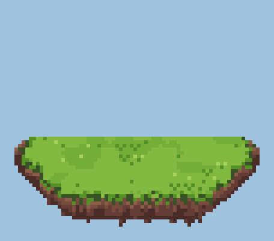

# Peons

**Un petit bonhomme par session Claude Code, sur une île d'herbe qui flotte sur ton bureau.**

Tu lances trois, quatre, sept sessions Claude Code. Laquelle travaille ? Laquelle t'attend depuis dix minutes sans oser le dire ? Laquelle s'est endormie ? Laquelle est presque à court de contexte ?

Plus besoin de faire le tour des terminaux. Un coup d'œil sur l'île et tu sais : chaque bonhomme (le « clawd ») mime ce que fait **son** agent, en direct.

<p align="center">
  
</p>

De gauche à droite : il creuse, il attend ta réponse, il compacte, il est content, il dort. Pas de fenêtre à ouvrir, pas de terminal à fouiller : l'île reste au-dessus des autres fenêtres, transparente, et tu peux la glisser où tu veux.

## Installation

Windows uniquement. Une commande :

```
claude plugin install peons --marketplace aero-md/peons
```

Au démarrage de la prochaine session, le plugin branche les hooks et télécharge `peons.exe` depuis les releases GitHub (SHA-256 vérifié). Le tout premier démarrage peut afficher « erreur normale au premier lancement » : l'exe est encore en cours de téléchargement, sans conséquence. Les sessions déjà ouvertes ne sont prises en compte qu'à leur redémarrage.

Mises à jour : `/peons:update` pour l'exe, `claude plugin update peons@peons` pour le plugin. Si d'anciens hooks de peons traînent dans `~/.claude/settings.json`, l'application le signale : retire-les, sinon chaque événement arrive en double. Mise à jour automatique du plugin, commandes, fonctionnement du hook, architecture : tout est dans [`docs/technique.md`](docs/technique.md).

## Ce que chaque état veut dire

### Claude s'active

<table>
<tr>
<td align="center" width="33%"><br><b>Il creuse</b><br>Claude travaille. La roche se fend peu à peu (ici en accéléré), explose au bout d'une minute, puis une neuve tombe du ciel.</td>
<td align="center" width="33%"><br><b>Panneau « ! »</b><br>Claude te demande une permission et attend ta réponse. C'est le seul qui a vraiment besoin de toi.</td>
<td align="center" width="33%"><br><b>Écrasé par un piston</b><br>Claude compacte son contexte. Ça pèse, il le montre.</td>
</tr>
</table>

### Claude a fini, et tu le laisses seul

Le temps passe, l'humeur change. Tout se règle dans les réglages ; par défaut :

<table>
<tr>
<td align="center" width="33%"><br><b>Content</b><br>Claude vient de finir une réponse. Ça dure 2 min.</td>
<td align="center" width="33%"><br><b>Neutre</b><br>Rien à signaler (c'est aussi son état au démarrage). 5 min.</td>
<td align="center" width="33%"><br><b>Triste</b><br>Tu l'as oublié. Il boude 10 min, puis il s'endort.</td>
</tr>
<tr>
<td align="center" width="33%"><br><b>Endormi</b><br>Il dort jusqu'à ce que tu lui reparles.</td>
<td align="center" width="33%"><br><b>Au banc</b><br>Endormi depuis longtemps, il se réveille 20 s toutes les 15 min pour soulever de la fonte. Puis il se rendort.</td>
<td></td>
</tr>
</table>

### Il arrive, il part

<table>
<tr>
<td align="center" width="50%"><br><b>Nouvelle session</b><br>Un portail s'ouvre, le clawd en tombe. Bienvenue.</td>
<td align="center" width="50%"><br><b>Session terminée</b><br>Il se désagrège en poussière, façon Thanos, et les autres se resserrent. Même chose si tu fermes le terminal.</td>
</tr>
</table>

## Et les sous-agents ?

Quand une session lance des sous-agents (l'outil Agent), une petite particule flotte au-dessus de la tête du clawd pour chacun d'eux. Tu vois d'un coup d'œil combien bossent pour lui, sans que son corps change.

<p align="center">
  
</p>

- **Blanche, grande** : le sous-agent utilise des outils.
- **Blanche, petite** : il est vivant mais muet depuis plus de 10 s.
- **Verte** : la session principale a fini son tour et attend ses sous-agents.

Un sous-agent sans nouvelles depuis 2 minutes est oublié (au cas où il n'aurait jamais dit au revoir).

## Au survol, les détails

Passe la souris sur un bonhomme : une petite étiquette (Windows) apparaît avec

- le titre de la session (celui de l'onglet de ton terminal), et le dossier du projet dessous ;
- son état et depuis combien de temps, et l'outil en cours (`Bash`, `Edit`...) ;
- une **barre de contexte** : elle se remplit, et vire du vert au rouge à l'approche de la limite, avec le nombre de tokens restants. C'est une estimation, mais bien assez bonne pour savoir qui va bientôt avoir besoin d'un `/compact`.

## Un clic

Un clic sur un bonhomme met au premier plan le terminal de sa session et le fait clignoter. Dans Windows Terminal, l'onglet est retrouvé par son titre (UI Automation) : c'est une solution bancale, un onglet n'étant relié ni à un PID ni à `WT_SESSION`. Sans correspondance (titre dupliqué, tronqué ou changé à la main), seule la fenêtre passe au premier plan.

## Les réglages

Un double-clic sur l'île (ou « Réglages » dans le menu de l'icône de la zone de notification) ouvre une vraie fenêtre de réglages :

- la taille des clawd (de 1× à 8×), celle de l'étiquette de survol (de 1× à 4×, à part) et celle de l'île, qui grandit toute seule avec le nombre de bonhommes (8 affichés au plus), ou que tu peux fixer à la main, ou carrément cacher ;
- la durée des humeurs : content, neutre, triste ;
- « toujours afficher », même quand aucune session n'est ouverte (sinon l'île se cache) ;
- la liste des sessions et le détail de celle que tu as choisie.

## Depuis les sources

```powershell
.\build.ps1 -Out "$env:LOCALAPPDATA\peons\peons.exe"
claude plugin marketplace add .
claude plugin install peons@peons
```

Ça lance les tests, produit `peons.exe` (un seul fichier, sans DLL) à l'endroit où les hooks du plugin l'attendent, puis installe le plugin depuis ta copie du dépôt.

## D'où ça vient

Peons est **inspiré de [Notchi](https://github.com/sk-ruban/notchi)**, l'app macOS de sk-ruban où une petite mascotte vit dans l'encoche du Mac et réagit à Claude Code. L'idée de départ, c'est la sienne ; ici, un bonhomme par session, sur une île, dans une fenêtre transparente.

Licences, attributions et origine des images et de la police : voir [`LICENSE`](LICENSE) et [`UPSTREAM.md`](UPSTREAM.md).
